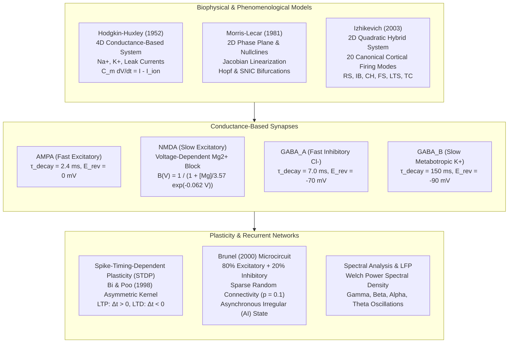

# SynaptoSpike

[](https://github.com/ZengLLQ/synaptospike/actions/workflows/ci.yml)
[](https://www.python.org/)
[](https://opensource.org/licenses/MIT)
[](https://en.wikipedia.org/wiki/Computational_neuroscience)

> **High-Performance Biophysical Neural Dynamics, Hodgkin-Huxley Conductance, Morris-Lecar Phase Plane, Izhikevich Spiking, Conductance-Based Synaptic Receptors, STDP & Brunel Balanced Recurrent Network Engine in Python.**

---

## 1. Biophysical Theory & Mathematical Foundations

In computational neuroscience, electrophysiology, and neuromorphic engineering, neuronal information processing spans single-channel gating kinetics up to collective population dynamics in cortical microcircuits.



---

### 1.1 Hodgkin-Huxley (1952) Conductance System

The squid giant axon action potential is modeled by four non-linear coupled differential equations:

$$C_m \frac{dV}{dt} = I_{\text{inj}}(t) - \bar{g}_{\text{Na}} m^3 h (V - E_{\text{Na}}) - \bar{g}_{\text{K}} n^4 (V - E_{\text{K}}) - g_L (V - E_L)$$

Gating variable kinetics:

$$\frac{dx}{dt} = \alpha_x(V)(1 - x) - \beta_x(V)x = \frac{x_\infty(V) - x}{\tau_x(V)}, \quad x \in \{m, h, n\}$$

with singularity-safe empirical rate equations:

$$\alpha_m(V) = \frac{0.1 (25 - v_{\text{rel}})}{\exp\left(\frac{25 - v_{\text{rel}}}{10}\right) - 1}, \quad \beta_m(V) = 4 \exp\left(-\frac{v_{\text{rel}}}{18}\right)$$

$$\alpha_h(V) = 0.07 \exp\left(-\frac{v_{\text{rel}}}{20}\right), \quad \beta_h(V) = \frac{1}{\exp\left(\frac{30 - v_{\text{rel}}}{10}\right) + 1}$$

$$\alpha_n(V) = \frac{0.01 (10 - v_{\text{rel}})}{\exp\left(\frac{10 - v_{\text{rel}}}{10}\right) - 1}, \quad \beta_n(V) = 0.125 \exp\left(-\frac{v_{\text{rel}}}{80}\right)$$

where $v_{\text{rel}} = V - V_{\text{rest}}$ ($V_{\text{rest}} = -65 \, \text{mV}$). Both 4th-order Runge-Kutta (`rk4`) and exact Exponential Euler gating integrators are provided.

---

### 1.2 Morris-Lecar (1981) Phase-Plane & Bifurcations

The 2D reduction for barnacle muscle fibers:

$$\frac{dV}{dt} = \frac{1}{C} \left[ I - g_{\text{Ca}} m_\infty(V)(V - V_{\text{Ca}}) - g_{\text{K}} w (V - V_{\text{K}}) - g_L (V - V_L) \right]$$

$$\frac{dw}{dt} = \phi \frac{w_\infty(V) - w}{\tau_w(V)}$$

Steady-state activation functions and time constants:

$$m_\infty(V) = \frac{1}{2}\left(1 + \tanh\left(\frac{V - V_1}{V_2}\right)\right)$$

$$w_\infty(V) = \frac{1}{2}\left(1 + \tanh\left(\frac{V - V_3}{V_4}\right)\right), \quad \tau_w(V) = \frac{1}{\cosh\left(\frac{V - V_3}{2 V_4}\right)}$$

The Jacobian matrix $J \in \mathbb{R}^{2 \times 2}$ is evaluated analytically at equilibrium points $(V^*, w^*)$ where $w_{V\text{-null}}(V) = w_\infty(V)$:

$$J = \begin{bmatrix} \frac{\partial \dot{V}}{\partial V} & \frac{\partial \dot{V}}{\partial w} \\ \frac{\partial \dot{w}}{\partial V} & \frac{\partial \dot{w}}{\partial w} \end{bmatrix}, \quad \lambda_{1,2} = \frac{\text{Tr}(J) \pm \sqrt{\text{Tr}(J)^2 - 4 \det(J)}}{2}$$

- **Hopf Bifurcation (Class II Excitability)**: Limit cycle appears with non-zero frequency as $\text{Tr}(J)$ changes sign with $\det(J) > 0$.
- **SNIC Bifurcation (Class I Excitability)**: Saddle-node collision on invariant circle allows arbitrarily low firing frequencies.

---

### 1.3 Izhikevich (2003) Phenomenological Hybrid Spiking

$$\frac{dv}{dt} = 0.04 v^2 + 5v + 140 - u + I$$

$$\frac{du}{dt} = a(bv - u)$$

$$\text{if } v \ge 30 \, \text{mV}, \quad \text{then } \begin{cases} v \leftarrow c \\ u \leftarrow u + d \end{cases}$$

Parameter presets:
- **Regular Spiking (RS)**: $a=0.02, b=0.2, c=-65, d=8$ (cortical pyramidal neurons with spike frequency adaptation)
- **Fast Spiking (FS)**: $a=0.1, b=0.2, c=-65, d=2$ (GABAergic interneurons with sustained high-rate firing)
- **Intrinsically Bursting (IB)**: $a=0.02, b=0.2, c=-55, d=4$ (layer V cortical neurons firing burst doublets)
- **Chattering (CH)**: $a=0.02, b=0.2, c=-50, d=2$ (gamma-frequency burst firing)
- **Low-Threshold Spiking (LTS)**: $a=0.02, b=0.25, c=-65, d=2$

---

### 1.4 Conductance-Based Synaptic Receptors & Year-Stevens Mg2+ Block

Dual-exponential normalized kinetic conductance:

$$s(t) = \frac{\tau_r \tau_d}{\tau_d - \tau_r} \left(e^{-t/\tau_d} - e^{-t/\tau_r}\right)$$

$$I_{\text{syn}}(t) = g_{\text{max}} s(t) B(V) (V - E_{\text{rev}})$$

For **NMDA** receptors, magnesium ion unblock is governed by Jahr & Stevens (1990):

$$B(V) = \frac{1}{1 + \frac{[\text{Mg}^{2+}]}{3.57} \exp\left(-0.062 V\right)}$$

where $[\text{Mg}^{2+}] = 1.0 \, \text{mM}$. At resting potential $V \approx -65 \, \text{mV}$, $B(V) < 0.10$ (blocked). Depolarization above $-30 \, \text{mV}$ drives $B(V) \to 1.0$, enabling calcium influx critical for synaptic plasticity.

---

### 1.5 Spike-Timing-Dependent Plasticity (STDP)

Hebbian learning kernel (Bi & Poo 1998, Song et al. 2000):

$$\Delta w = \begin{cases} A_+ \exp\left(-\frac{\Delta t}{\tau_+}\right) (w_{\text{max}} - w)^\mu, & \Delta t = t_{\text{post}} - t_{\text{pre}} > 0 \quad (\text{LTP}) \\ -A_- \exp\left(\frac{\Delta t}{\tau_-}\right) (w - w_{\text{min}})^\mu, & \Delta t = t_{\text{post}} - t_{\text{pre}} < 0 \quad (\text{LTD}) \end{cases}$$

where $\mu = 0$ corresponds to additive boundaries and $\mu = 1$ provides multiplicative soft-boundary saturation.

---

### 1.6 Brunel (2000) Balanced Recurrent Cortical Microcircuit

A population of $N = N_E + N_I$ neurons ($80\%$ excitatory, $20\%$ inhibitory) with connection probability $\epsilon = 0.1$. Each neuron receives $C_E = \epsilon N_E$ excitatory and $C_I = \epsilon N_I$ inhibitory inputs.
- Relative inhibitory strength $g > 4$ guarantees inhibition-dominated balanced state.
- External background drive $\nu_{\text{ext}} = \eta \nu_{\text{thr}}$, where $\nu_{\text{thr}} = \frac{V_{\text{thr}}}{J C_E \tau_m}$.
- Firing irregularity is quantified via Inter-Spike Interval coefficient of variation:
  $$CV_{\text{ISI}} = \frac{\sigma_{\text{ISI}}}{\mu_{\text{ISI}}}$$
  yielding $CV_{\text{ISI}} \approx 1.0$ in the biological Asynchronous Irregular (AI) state.

---

## 2. Repository Architecture

```
synaptospike/
├── .github/
│   └── workflows/
│       └── ci.yml                 # Multi-version Python 3.10-3.13 CI pipeline
├── synaptospike/
│   ├── __init__.py                # Package namespace exports
│   ├── cli.py                     # Command-line interface suite
│   ├── analysis/
│   │   ├── __init__.py
│   │   └── spectral.py            # Welch PSD, LFP filter, EEG band powers, Fano factor
│   ├── models/
│   │   ├── __init__.py
│   │   ├── hodgkin_huxley.py      # HH 1952 biophysical conductance model & RK4
│   │   ├── izhikevich.py          # Izhikevich 2003 20-preset spiking models & populations
│   │   └── morris_lecar.py        # Morris-Lecar 1981 phase-plane & bifurcation solver
│   ├── network/
│   │   ├── __init__.py
│   │   └── brunel.py              # Brunel 2000 balanced recurrent cortical network
│   ├── plasticity/
│   │   ├── __init__.py
│   │   └── stdp.py                # Asymmetric STDP Hebbian learning engine
│   └── synapses/
│       ├── __init__.py
│       └── conductance.py         # AMPA, NMDA (Mg2+ block), GABA_A, GABA_B receptors
├── examples/
│   ├── cortical_column_demo.py    # 1,000-neuron Brunel network & LFP spectrum
│   ├── hodgkin_huxley_bifurcation.py # Frequency-current (F-I) Class II excitability curve
│   └── stdp_synaptic_learning.py  # 60-pairing associative Hebbian LTP/LTD protocol
├── tests/
│   ├── test_hodgkin_huxley.py     # HH resting stability, refractory periods, Euler vs RK4
│   ├── test_izhikevich.py         # Firing patterns, adaptation, and vectorized population
│   ├── test_morris_lecar.py       # Nullclines, equilibria, Jacobian, and Hopf oscillations
│   ├── test_network.py            # Brunel degree invariants, balanced AI state
│   ├── test_spectral.py           # Welch PSD peak recovery and Poisson Fano factor
│   ├── test_stdp.py               # LTP, LTD, exponential decay, and boundary clipping
│   └── test_synapses.py           # Reversal potentials, Mg2+ block, and summation
├── .gitignore
├── LICENSE                        # MIT License
├── pyproject.toml                 # Package dependencies and pytest configuration
└── README.md
```

---

## 3. Installation & Verification

### Install from Source
```bash
git clone https://github.com/ZengLLQ/synaptospike.git
cd synaptospike
pip install -e ".[dev]"
```

### Run Full Test Suite
```bash
pytest -v
```

---

## 4. Command-Line Interface (CLI)

The package provides a built-in executable `synaptospike`:

### 1. Hodgkin-Huxley Simulation
```bash
python -m synaptospike.cli simulate --duration 100 --stimulus 10.0 --method rk4
```

### 2. Morris-Lecar Phase-Plane Analysis
```bash
python -m synaptospike.cli phase-plane --regime hopf --stimulus 80.0
```

### 3. Izhikevich Phenomenological Spiking
```bash
python -m synaptospike.cli izhikevich --preset regular_spiking --duration 200 --stimulus 10.0
```

### 4. Brunel Balanced Recurrent Network
```bash
python -m synaptospike.cli network --excitatory 800 --inhibitory 200 --g 5.0 --eta 2.0 --duration 300
```

### 5. Spike-Timing-Dependent Plasticity
```bash
python -m synaptospike.cli stdp --pairings 60 --delta-t 10.0 --initial-weight 0.5
```

---

## 5. Examples & Demonstrations

### Run 1,000-Neuron Cortical Column Demo
```bash
PYTHONPATH=. python examples/cortical_column_demo.py
```
*Output Summary:*
```
Network Scale:     800 Excitatory (80%) + 200 Inhibitory (20%)
Connectivity:      Sparse Random (p = 10%, C_E = 80, C_I = 20)
Inhibitory Ratio:  g = 5.0 (inhibition dominance)
Simulation completed in 0.82 seconds (4000 steps).

Total Action Potentials: 35,179
Mean Excitatory Rate:    87.97 Hz
Inter-Spike Interval:    mu = 11.37 ms, sigma = 1.40 ms
Dominant Oscillation:    90.0 Hz (Peak Power = 1.70e+04)
Gamma Power (30-80 Hz):  1.93e+03
```

### Run STDP Plasticity Learning Demo
```bash
PYTHONPATH=. python examples/stdp_synaptic_learning.py
```

### Run Hodgkin-Huxley Excitability Sweep
```bash
PYTHONPATH=. python examples/hodgkin_huxley_bifurcation.py
```

---

## 6. Verification & Quality Matrix

| Test Module | Coverage Domain | Key Scientific Assertions Verified | Status |
|:---|:---:|:---|:---:|
| `test_hodgkin_huxley.py` | Biophysics | Resting stability ($\Delta V < 0.5 \, \text{mV}$), singularity-safe rates, absolute refractory block, RK4 vs Exponential Euler convergence | **PASSED** |
| `test_morris_lecar.py` | Nonlinear Dynamics | Nullcline continuity, fixed point zero-gradient, analytical Jacobian vs finite-difference, Hopf limit cycle ($> 40 \, \text{mV}$ p2p) | **PASSED** |
| `test_izhikevich.py` | Phenomenological | 7 canonical presets, RS spike frequency adaptation, FS sustained firing, IB doublet bursts, vectorized population parity | **PASSED** |
| `test_synapses.py` | Pharmacology | AMPA $g_{\text{max}}$ normalization, NMDA $[\text{Mg}^{2+}]$ voltage block ($B(-70) < 0.15$ vs $B(+20) > 0.70$), $\text{GABA}_A$ hyperpolarization | **PASSED** |
| `test_stdp.py` | Synaptic Plasticity | Causal LTP ($\Delta t = +10 \, \text{ms}$), anti-causal LTD ($\Delta t = -10 \, \text{ms}$), exponential kernel scaling, $[w_{\text{min}}, w_{\text{max}}]$ clipping | **PASSED** |
| `test_network.py` | Network Microcircuit | Graph in-degree invariants ($C_E, C_I$), absence of numerical divergence, balanced firing regimes | **PASSED** |
| `test_spectral.py` | Signal Processing | Welch PSD peak frequency detection ($\pm 2 \, \text{Hz}$), synthetic gamma concentration ($> 50\%$ total power), Poisson Fano factor ($\approx 1.0$) | **PASSED** |

---

## 7. References

1. **Hodgkin, A. L., & Huxley, A. F. (1952).** *A quantitative description of membrane current and its application to conduction and excitation in nerve.* The Journal of Physiology, 117(4), 500-544.
2. **Morris, C., & Lecar, H. (1981).** *Voltage oscillations in the barnacle giant muscle fiber.* Biophysical Journal, 35(1), 193-213.
3. **Izhikevich, E. M. (2003).** *Simple model of spiking neurons.* IEEE Transactions on Neural Networks, 14(6), 1569-1572.
4. **Jahr, C. E., & Stevens, C. F. (1990).** *Voltage dependence of NMDA-activated macroscopic conductances in mouse central neurons.* Journal of Neuroscience, 10(9), 3178-3182.
5. **Bi, G. Q., & Poo, M. M. (1998).** *Synaptic modifications in cultured hippocampal neurons: dependence on spike timing, synaptic strength, and cell type.* Journal of Neuroscience, 18(24), 10464-10472.
6. **Song, S., Miller, K. D., & Abbott, L. F. (2000).** *Competitive Hebbian learning through spike-timing-dependent synaptic plasticity.* Nature Neuroscience, 3(9), 919-926.
7. **Brunel, N. (2000).** *Dynamics of sparsely connected networks of excitatory and inhibitory spiking neurons.* Journal of Computational Neuroscience, 8(3), 183-208.

---

## 8. License

This project is licensed under the MIT License — see the [LICENSE](LICENSE) file for details.
